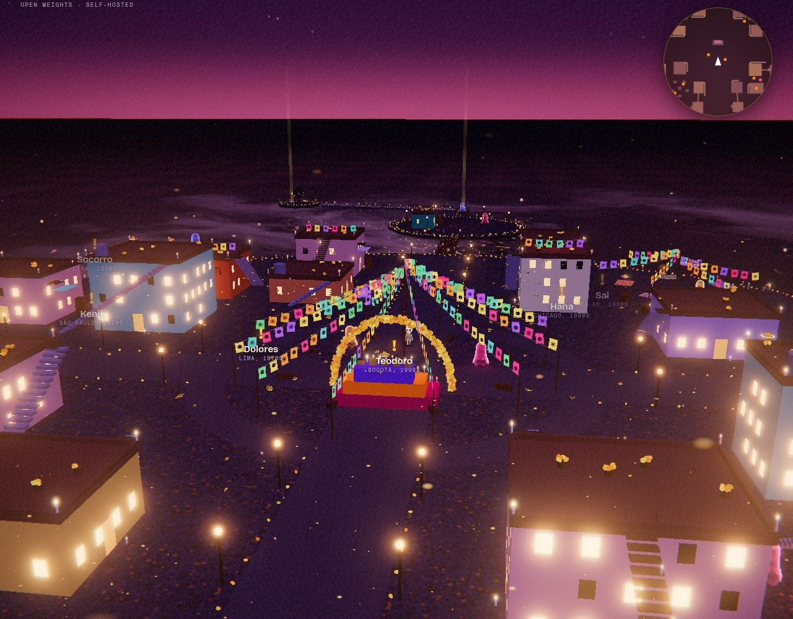

# 💀 ÁNIMAS

**The last mail carrier in the land of the dead. Every ghost, and every letter they send each other, is written by an open-weight model.**

A 3D exploration game for Día de los Muertos. You are a small calaca in a striped serape and a crown of marigolds, walking the town of Mictlán on the one night the souls go home. Ghosts wander its plaza, rooftops and outer islands. Some want a letter carried to another ghost; some miss one small thing waiting somewhere in the world. Deliver it, and they cross over, rising into a sky of lanterns that everyone online shares.

Every ghost and every letter is written by **Gemma 4**, running on your own machine or server, under JSON-Schema grammars.



Built for the [DEV Hacktoberfest Open-Source AI Challenge, Week 4: Ghost in the Machine](https://dev.to/challenges/hacktoberfest-week4-2026-10-26).

## Play

| | |
|---|---|
| `W A S D` | walk (`Shift` to run) |
| `Space` | jump, press again in the air for a flip |
| `E` | talk · deliver · the mailbox · summon someone at the altar |
| `M` / `Tab` | the map / switch the delivery you're tracking |
| `1 2 3` | choose what to say |
| `F` | dance |
| mouse | look around: click the world once, then just move the mouse (`Esc` frees the cursor). If your browser blocks that, hold a button and drag. `W A S D` always walks relative to where you look |
| touch | a floating thumbstick on the left half, drag the right half to look, buttons for jump, talk and dance |

**The loop:** walk up to a ghost with a **!** → hear their story → they hand you a letter for another ghost, or ask for something they miss → your mail bag holds up to four deliveries → find the recipient (or follow the golden light to the object) → they read the letter aloud, or take the object → the ghost rises as a lantern. If a letter's recipient crossed over before you got there, post it in the red mailbox by the Correo. The world is shared: when anyone frees a ghost, everyone sees it rise, and a new ghost written by Gemma takes its place.

**Wings:** free 3 souls and they give you wings (flap with `Space` in the air, hold to glide); 6 for marigold wings; 10 and you're the Ángel de Mictlán, with a halo, almost free flight, and access to La Nube, a cloud island that only wings can reach. Progress is saved in your browser (`?wings=1|2|3` to try them right away).

**Other mail carriers (solo mode):** 3–4 NPC calacas with names and tags walk the streets doing their rounds (stopping by ghosts, carrying errands, dancing), and 1–2 winged ones fly over the rooftops and land on them, so you can see what's waiting for you. They come and go every few minutes and never interact with you. They're bots, not players; add `?nobots` to the URL to turn them off.

**Houses you can walk into:** three of them (Casa de la Abuela, Taller del Relojero, Casa Azul) have a doorway, furniture (tables, beds, a stove, bookshelves, a little ofrenda, a watchmaker's bench), a warm lamp and an indoor staircase up to a hatch onto the roof. Three of the errand objects and a few calaveras are hidden inside; one ghost lives in the abuela's house. Inside you see real walls and a ceiling (you bump your head if you jump); the camera moves in closer and your wings fold.

**Explore:** every roof is walkable (outside stairs, crates, awnings, planks between roofs), the chapel's bell tower can be climbed, the hillside terraces lead to a high plank out to La Campana, and stepping stones lead across the water and up to El Mirador. Golden calaveras hide in the hard-to-reach places.

## The world

- **The town:** a plaza with a great ofrenda, four barrios of walkable-roofed houses (Capilla, Alto, Correo, Cantina), streets lined with marigolds and lamps, ~100 box colliders, generated from a fixed seed so everyone gets the same town.
- **Outer islands:** El Panteón, El Mercado Flotante, La Huerta, El Muelle with a long dock, La Isleta, La Campana and El Mirador, connected by rope bridges, planks and floating stones.
- **Collision:** pads (round islands, cliffs are walls), boxes (walkable tops, solid sides) and ramps (stairs, planks, bridges). Step-up 0.8 m, jump ~2 m, double jump ~3.5 m, coyote time, a camera that pulls in when a house gets in the way.
- **Fair by construction:** a BFS reachability check over the whole map (same movement rules as the character) confirms every calavera, object and ghost can be reached from the plaza.
- **The calaca and the ghosts** are built from primitives in code (no model files), with procedural animation, shaders and Web Audio babble.

## Multiplayer (how players see each other)

No CRDT, no Yjs, no WebSocket library. Players don't co-edit anything, they just need to see where everyone is, so the server is the single source of truth and last-write-wins is enough:

```
browser ──POST /api/move (≈8/s: id, name, position, pose, item)──▶ server.js (in memory: players Map)
browser ◀──GET /events (Server-Sent Events)── every 120 ms: [id, x, y, z, facing, speed, hue, item, dance, air, name, tag] for everyone
```

- Each tab gets a random private `id` (sessionStorage). The server assigns a short public **tag** (`#0042`) the first time it sees that id, so two players called "Lupe" show up as `Lupe #0003` and `Lupe #0004`. Names live in localStorage; click your name in the corner to change it.
- Clients interpolate other players and animate them with the same procedural rig (walk, jump, dance, carrying).
- The same SSE stream carries world events: new ghosts, new letters, freed ghosts, lanterns.
- Players who stop sending for 15 s disappear.

**Deploying:** this needs a long-running Node process (Render web service, Fly.io, a DigitalOcean droplet, any VPS, `docker compose`). Static hosts (GitHub Pages, Vercel static) can only serve `docs/demo.html`, which is single-player. Because state is in memory, run **one instance**; scaling out would need Redis pub/sub (or similar) between instances. If you put it behind Nginx, disable buffering for `/events` (the server already sends `X-Accel-Buffering: no`).

## Limits (so a crowd, or a bot, can't sink the server)

| what | default | env |
|---|---|---|
| open `/events` streams | 150 total, 10 per IP | `MAX_CLIENTS`, `MAX_CLIENTS_PER_IP` |
| calacas broadcast to everyone | 60 total, 6 per IP | `MAX_PLAYERS`, `MAX_PLAYERS_PER_IP` |
| position updates | 1 per player per 80 ms (extra ones are dropped) | |
| request bodies | 600 B (move) / 4 KB (summon) | |
| summons | 1 per IP per minute; Gemma writes one at a time with 2 waiting; 60 per hour | `MAX_SUMMONS_PER_HOUR` |
| freeing ghosts | 1 per IP per 4 s | |
| slow requests | headers 10 s, body 15 s | |

When the town is full, new visitors get an `event: full` and drop into solo mode with the seeded ghosts instead of an error; players who are blocked from being seen get a red notice ("Mictlán is full tonight" / "Too many players from your network"), can keep playing, and retry every 12 s. Set `TRUST_PROXY=1` only behind a real proxy (Render, Fly, Nginx) so per-IP limits use `X-Forwarded-For`; otherwise that header is ignored so it can't be spoofed.

## How Gemma writes the mail

Letters are written between two ghosts that are both wandering right now. The server hands Gemma both lives and asks it to invent the connection, under a grammar:

```js
{ relation, ask, letter: { pattern: "^Dear [^,]{1,30}, .{60,400}$" }, reply }
```

The pattern exists because early on, half the "letters" came back as descriptions of letters ("From Kofi to Sal, referencing shared memories"). A one-line example plus a grammar that forces the field to start with "Dear <name>," fixed it.

## How Gemma writes a ghost

The server keeps a pool of ghosts written ahead of time and refills it in the background. For each one it rolls dice: name, place, decade, job, personality, soul color, and the object they miss (which follows from the job: a baker misses pan dulce, a clockmaker a pocket watch). Then it builds a grammar for that one ghost, with the object pinned as a single-value enum placed *first*, and Gemma writes the person:

```js
{ accepted, item: enum([rolled object]), name, from, life, personality: enum([rolled]), color: enum([rolled]),
  greeting, memory, ask, thanks, epitaph }
```

Why pin it? When Gemma could choose freely among the 12 objects, 9 of 24 ghosts chose the marigold crown and then asked for a spoon or a fountain pen in their dialogue. The grammar guarantees the shape; the dice keep the meaning. Every quest is solvable because the object physically exists on an island. Summoned ghosts choose their own object (item first, then prose). `accepted` lets the same model quietly refuse abusive summons.

Grammar-constrained decoding runs through any of three runtimes (`GEMMA_RUNTIME`):

| runtime | how the grammar is enforced |
|---|---|
| `ollama` (default) | `/api/chat` with `format: <schema>` and `think: false` |
| `llamacpp` | `/apply-template`, then an empty Gemma 4 thought channel, then `/completion` with `json_schema` |
| `openai` | any OpenAI-compatible server with `response_format: json_schema` |

## Run it

```bash
ollama pull gemma4:e4b && ollama serve      # the keeper (gemma4:e2b on small machines)
npm start                                     # zero npm dependencies → http://localhost:3000
```

With llama.cpp:

```bash
llama-server -hf ggml-org/gemma-4-E2B-it-GGUF:Q4_0 --port 8080 --jinja --reasoning-format none
GEMMA_RUNTIME=llamacpp GEMMA_BASE_URL=http://localhost:8080 GEMMA_MODEL=gemma-4-e2b npm start
```

`npm run seed` writes the first ghosts; `node tools/seed-letters.mjs` writes the first letters between them. `docs/demo.html` is a single-file offline demo that plays with the seeded ghosts (no server, no multiplayer, no summoning).

**Deploy, single-player (default):** the game is fully static. Push the repo to Vercel (or Netlify, GitHub Pages…): `vercel.json` serves `public/`, and the game plays with the ghosts and letters in `public/seed-ghosts.json`. No server, no Gemma needed at runtime.

**Deploy with the keeper (new ghosts, letters and summoning written live by Gemma):** run `server.js` somewhere long-lived next to Ollama: `docker compose up -d`, or a Render Blueprint from `render.yaml`. Add `?multi` to the URL to turn the shared town (other players) back on; that code is still there.

| env | default |
|---|---|
| `GEMMA_RUNTIME` | `ollama` |
| `GEMMA_BASE_URL` | `http://localhost:11434/v1` |
| `GEMMA_MODEL` | `gemma4:e4b` |
| `PORT` / `DATA_DIR` | `3000` / `./data` |

## License

MIT · made by [Long Phan](https://github.com/longphanquangminh) for everyone we still set a place for.
